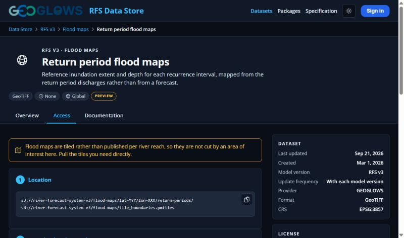
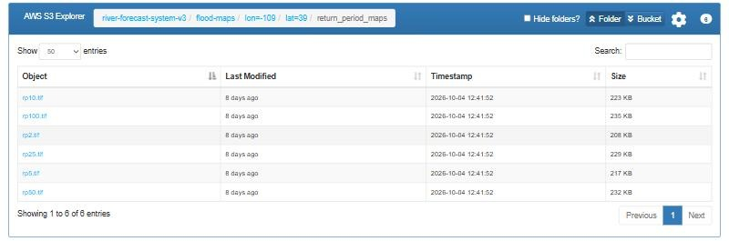

# Acceso a los Mapas de Inundación

Hay 3 formas de acceder a los mapas de inundación.

### 1. Herramienta en el Hydroviewer

Los mapas de inundación ahora están integrados en el [Hydroviewer](../../web-apps/hydroviewer.md), y un usuario puede verlos haciendo clic en un río y eligiendo un
valor de caudal de entrada. Estos mapas de inundación se calculan a partir de esta información y luego se muestran en la interfaz. Después,
el usuario puede descargar un GeoTIFF del mapa de inundación. Este GeoTIFF se puede cargar en un software SIG para verlo de otras formas.

### 2. A través del Almacén de Datos

Los mapas de inundación están disponibles a través del [almacén de datos](https://apps.geoglows.org/previews/rfs-data-store/datasets/v3){:target="_blank"}. Se proporciona código para crear y
descargar los mapas de inundación. Para obtener más información sobre cómo usar el almacén de datos, consulte [El Almacén de Datos](datastore.md).

### 3. En AWS

Los mapas de inundación por período de retorno están disponibles en el [bucket de AWS](https://v3.s3.riverforecastsystem.com/#flood-maps/){:target="_blank"}. Están indexados por su
longitud y latitud: cada carpeta, como `flood-maps/lon=-109/lat=39/`, cubre un mosaico de 1 grado por 1 grado. Dentro de cada mosaico, la
carpeta `return_period_maps` contiene un GeoTIFF para cada período de retorno (`rp2.tif`, `rp5.tif`, `rp10.tif`, `rp25.tif`, `rp50.tif` y
`rp100.tif`). Cada GeoTIFF es el mapa de inundación para un caudal igual al caudal de ese período de retorno.

