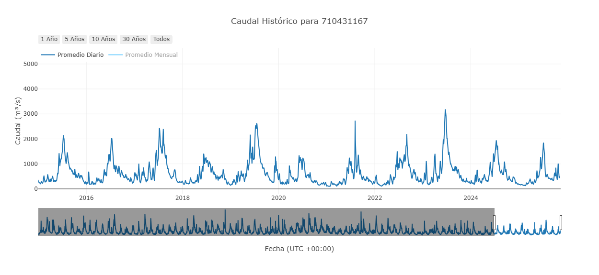
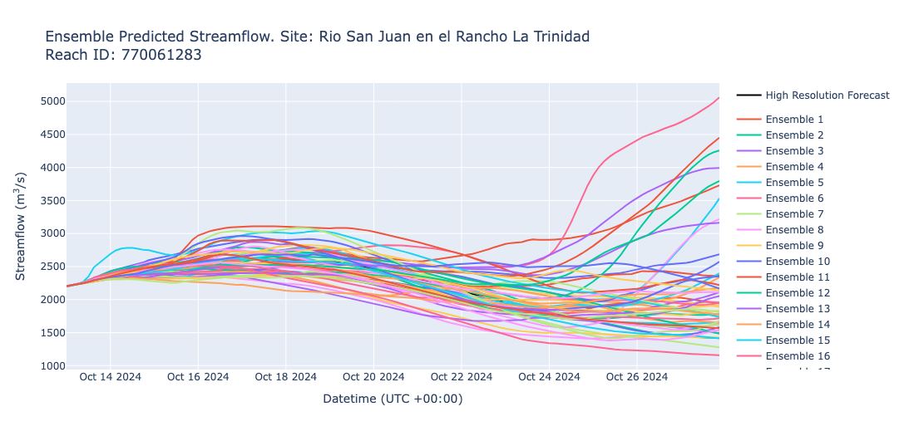
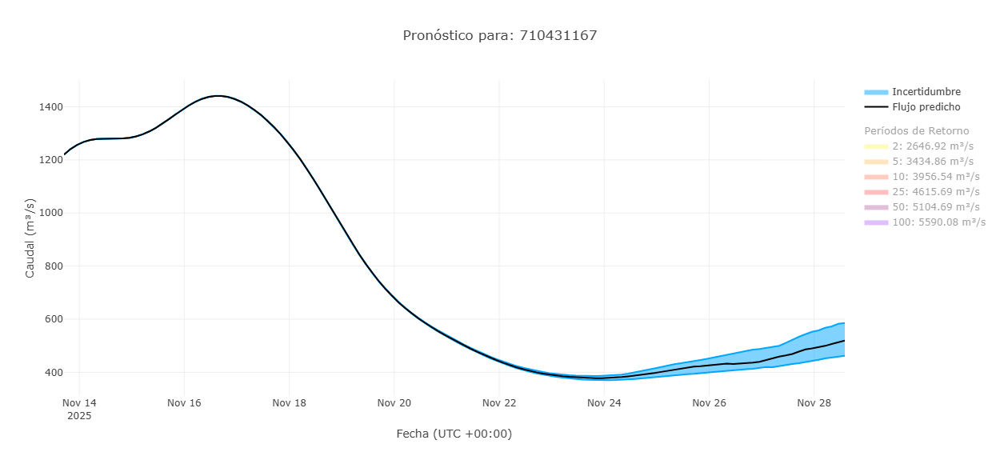
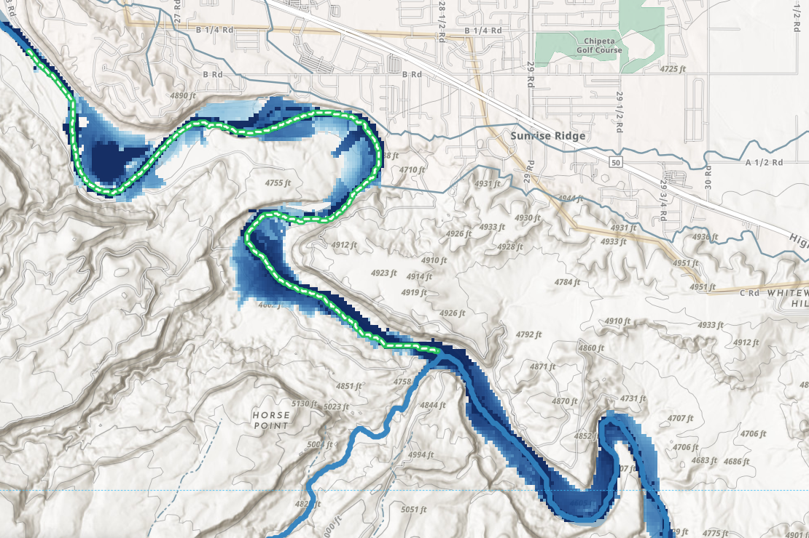

# Datos Disponibles

RFS produce valores de caudal en alrededor de 4.9 millones de ríos. Cada segmento de río tiene sus propios valores que se pueden descargar y utilizar. Los datos están disponibles a través del [almacén de datos](accessing-data/datastore.md) o de varias [aplicaciones web](../web-apps/overview.md). También hay opciones avanzadas para ver los datos mediante código; consulte nuestra [sección avanzada](accessing-data/advanced-methods.md).

Hay 3 conjuntos principales de datos.

1. Los datos retrospectivos
2. Los datos de pronóstico de 15 días
3. Los mapas de inundación

Cada uno se explica con más detalle en las siguientes secciones. También hay más información en el [almacén de datos](accessing-data/datastore.md).

## Datos Retrospectivos

### Descripción General

La simulación retrospectiva de RFS contiene datos de más de 85 años a resolución horaria, a partir del 1 de enero de 1940. El modelo es determinista, lo que significa que hay un solo valor por paso de tiempo en lugar de un ensamble de valores. La simulación retrospectiva y muchos productos derivados se actualizan semanalmente. 

La simulación retrospectiva proporciona caudales promedio horarios que se remuestrean a promedios diarios, mensuales y anuales. Los caudales se reportan como el promedio que ocurrió durante el siguiente intervalo (hora, día, mes o año). El valor dado representa el caudal promedio desde ese momento hasta el siguiente paso de tiempo. Todos los valores están en metros cúbicos por segundo.

---

### Productos Derivados

#### Periodos de Retorno

Un periodo de retorno es una estimación de cuán infrecuentemente ocurre un caudal alto extremo (inundación) o un periodo prolongado de caudal bajo (sequía). Los periodos de retorno han sido precalculados utilizando la Distribución de Gumbel y la Distribución Log-Pearson Tipo 3, y los caudales máximos horarios promedio de cada año completo. Los periodos de retorno precalculados se usan para definir niveles de alerta para cada segmento de río en el modelo. Los valores precalculados son para intervalos de recurrencia de 2, 5, 10, 25, 50 y 100 años. Puede calcular un periodo de retorno usando su método preferido accediendo al mismo conjunto de datos de máximos anuales.

#### Curvas de Duración de Caudal

**Las Curvas de Duración de Caudal (FDCs)** son una representación de los patrones de flujo en un río. Relacionan cada caudal con una probabilidad de excedencia. La probabilidad de excedencia es la posibilidad de que cualquier valor de caudal muestreado al azar sea mayor o igual al caudal correspondiente a esa probabilidad. Las grandes inundaciones tienen una baja probabilidad de excedencia, mientras que los caudales bajos tienen una alta probabilidad de excedencia. La FDC es una herramienta útil para entender la variabilidad del caudal y la probabilidad de diferentes tasas de flujo. Las FDCs están precalculadas para cada mes (es decir, 12 curvas en total que representan cada mes) y para todo el periodo de registro del río. Estas ayudan a comprender el caudal a lo largo del año y los cambios estacionales, lo cual es aplicable a la gestión efectiva de recursos hídricos, la previsión de inundaciones y la comprensión de los patrones hidrológicos.

## Datos de Pronóstico de 15 Días

### Descripción General

RFS produce pronósticos de caudal por ensamble utilizando datos IFS (Integrated Forecast System, Sistema Integrado de Predicción) del ECMWF. Los caudales se reportan en metros cúbicos por segundo. El pronóstico tiene un **paso de tiempo de 3 horas**, donde cada valor de caudal representa el caudal promedio ocurrido en el río durante las 3 horas anteriores. A continuación se muestra un gráfico de ejemplo con todos los miembros del ensamble.

Cada pronóstico incluye un **ensamble de 50+1 miembros**, lo que significa que hay **1 predicción base (control)** y **50 perturbaciones** (variaciones leves) de la condición base.

El pronóstico de cada día se inicializa utilizando como condición inicial el valor promedio de 24 horas de los miembros del ensamble del día anterior. 

### Interpretación de un Pronóstico por Ensamble

Cada miembro del ensamble tiene la misma probabilidad de ocurrir. Por lo tanto, los pronósticos se comprenden mejor observando resúmenes del ensamble en lugar de miembros individuales.

Los gráficos de pronóstico están diseñados para ayudar a los usuarios a interpretar el rango de posibles resultados e incertidumbres. El gráfico de pronóstico más común incluye la mediana, el percentil 20 y el percentil 80. Estos representan el 60% de la distribución de probabilidad dentro de los miembros del ensamble y brindan una idea de la posible variabilidad del caudal futuro. Este enfoque permite a los usuarios ver el rango de escenarios probables para sus ríos.

En el siguiente gráfico de pronóstico de ejemplo, hay 3 elementos clave a observar:

- **Línea Negra:** La mediana de los 51 miembros del ensamble. Es la "mejor estimación" del caudal del río.
- **Líneas Azules:** Los valores del percentil 20 y 80.
- **Área Sombreada Azul:** Representa la incertidumbre en la predicción. Es el 60% central del ensamble. Cuanto más estrecha sea la región azul, mayor será la confianza del modelo. Es más probable que el caudal real se encuentre dentro del área sombreada azul que fuera de ella.

<!-- Hidden for now: 45-day forecast section
## Datos de Pronóstico de 45 Días
Este es un marcador de posición para el contenido que irá aquí si se llega a producir.
-->

## Mapas de Inundación

Los mapas de inundación de RFS muestran el área que se inundaría a lo largo de un río, y la profundidad que alcanzaría el agua, para un
caudal determinado. Muestran únicamente las inundaciones causadas por ríos que se desbordan, no las causadas directamente por la lluvia.
Los mapas de inundación están actualmente en versión preliminar. Hay tres productos de mapas de inundación:

- **Mapas de inundación pronosticados**: La extensión y profundidad de la inundación prevista por cada pronóstico diario de 15 días.
- **Mapas de inundación por período de retorno**: La extensión y profundidad de la inundación para los caudales de cada período de
  retorno, como el caudal de 2 o de 100 años. No dependen de un pronóstico.
- **Bibliotecas de inundación (FLDPLN)**: Las tablas que se utilizan para convertir cualquier caudal en un mapa de inundación. Pueden
  usarse para crear sus propios mapas de inundación para el caudal que elija.

Para ver los mapas de inundación, utilice las herramientas de mapeo de inundaciones del [Hydroviewer](../web-apps/hydroviewer.md). Para descargarlos, consulte
[Acceso a los Mapas de Inundación](accessing-data/flood-maps.md). Para saber cómo se elaboran, consulte [Mapeo de Inundaciones](../model-formulation/flood-mapping.md) en la sección de
Formulación del Modelo.
