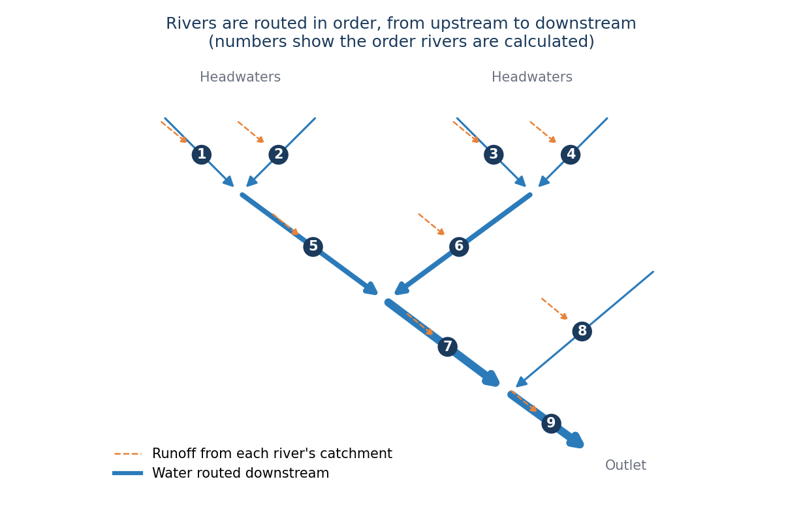
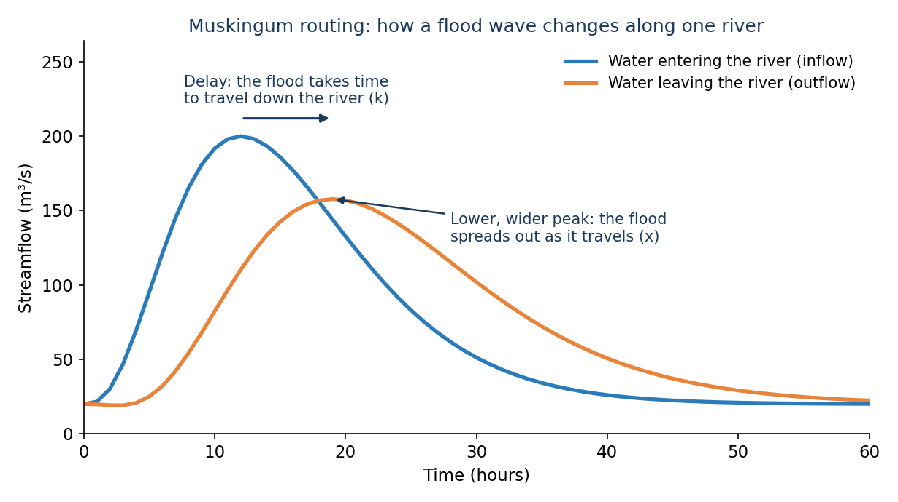

# Enrutamiento Fluvial

!!! warning "Advertencia"
    El propósito de esta sección sobre la formulación del modelo es proporcionar una visión general del RFS, incluyendo sus entradas y resultados. Si le interesa principalmente usar los datos, puede omitir esta sección y pasar a la sección [Datos](../data/available-data.md) de nuestro sitio.

El enrutamiento es el paso en el que RFS mueve el agua a través de la red de ríos. Una vez calculada la escorrentía de la cuenca de
cada río (consulte el [Resumen](model-formulation.md)), el enrutamiento lleva esa agua aguas abajo, río por río, para crear un hidrograma
para cada río. RFS utiliza [river-route](https://river-route.code.hales.app/){:target="_blank"}, un paquete de Python desarrollado por el Dr. Riley Hales para enrutar
el agua a través de redes de ríos muy grandes de forma rápida. El código está disponible en [GitHub](https://github.com/rileyhales/river-route){:target="_blank"}.

## Cómo se Mueve el Agua a Través de la Red

En cada paso de tiempo, la escorrentía de la cuenca de un río se suma a ese río, junto con toda el agua que llega de los ríos situados
inmediatamente aguas arriba. Como el caudal de un río depende de todo lo que hay aguas arriba, los ríos se calculan en orden de aguas
arriba hacia aguas abajo: primero los ríos de cabecera y al final la salida. Este es el orden que se guarda en el atributo `riverIndex` de
la hidrografía de RFS.

## Enrutamiento de Muskingum

RFS utiliza el método de Muskingum para calcular cómo se mueve el agua a través de cada río. Este método estima el agua que sale de un río
en el siguiente paso de tiempo (\(Q_{t+1}\)) a partir del agua que entra en el siguiente paso de tiempo (\(I_{t+1}\)), el agua que
entra ahora (\(I_t\)) y el agua que sale ahora (\(Q_t\)):

$$
Q_{t+1} = c_1 I_{t+1} + c_2 I_t + c_3 Q_t
$$

Los coeficientes \(c_1\), \(c_2\) y \(c_3\) suman 1, por lo que no se gana ni se pierde agua. Se calculan a partir de la duración
del paso de tiempo y de dos parámetros que se definen para cada río:

- **k**: el tiempo que tarda una onda de crecida en recorrer la longitud del río. Los ríos más largos y lentos tienen valores de k más
  grandes.
- **x**: cuánto se extiende y se aplana la onda de crecida al avanzar, desde 0 (el mayor aplanamiento) hasta 0.5 (ninguno).

En conjunto, estos parámetros retrasan la onda de crecida y la extienden a medida que avanza aguas abajo. Los valores de cada río se
incluyen en la hidrografía de RFS como los atributos `musk_k` y `musk_x`.

## Pasos de Tiempo

river-route enruta el agua con un paso de tiempo igual o más corto que el paso de tiempo de los datos de escorrentía, de modo que cada
valor de escorrentía se enruta al menos una vez. Luego, los caudales enrutados se promedian en los pasos de tiempo de los resultados de RFS:

- **Simulación retrospectiva**: caudales promedio horarios, que luego se combinan en promedios diarios, mensuales y anuales.
- **Pronósticos**: caudales promedio cada 3 horas para cada uno de los 15 días del pronóstico.

## Más Información

Para ver el enrutamiento en acción, pruebe la demostración interactiva de la página [Resumen del Modelo](../background/model-overview.md).
Para conocer todos los detalles del método, incluidas las matemáticas, lea la [documentación de river-route](https://river-route.code.hales.app/){:target="_blank"} y
sus [derivaciones matemáticas](https://river-route.code.hales.app/references/math/){:target="_blank"}.
