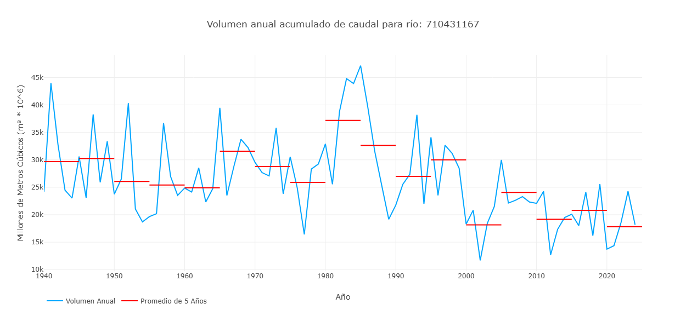
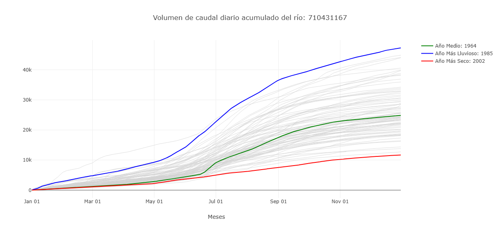
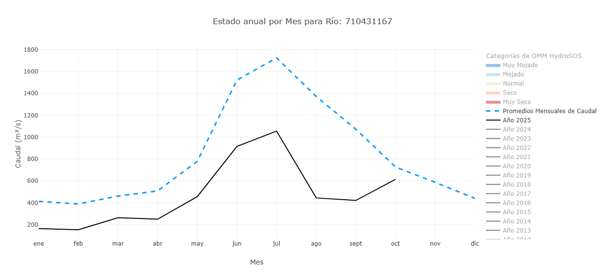
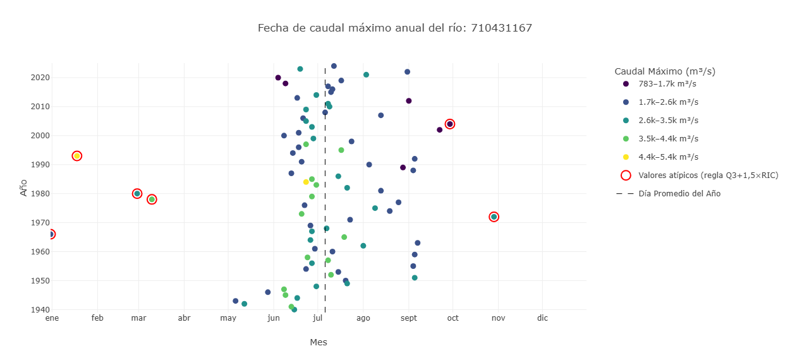
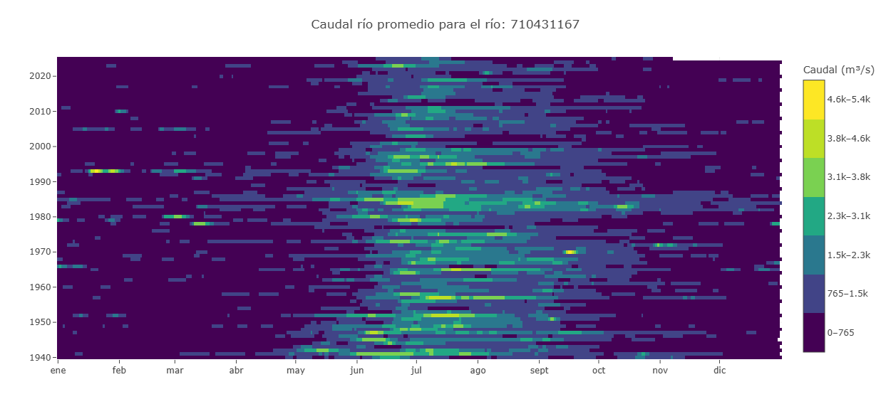
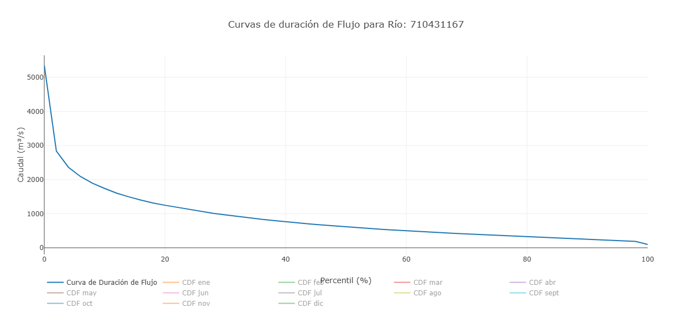

# Uso del RFS Hydroviewer

## Resumen
El [RFS Hydroviewer](https://apps.geoglows.org/previews/rfs-v3) es una herramienta web para visualizar y acceder a pronósticos de caudal y datos históricos a nivel mundial. Permite a los usuarios:

- Explorar las condiciones de caudal en tiempo real  
- Analizar tendencias de pronóstico  
- Revisar simulaciones hidrológicas de cualquier río  
- Mapear posibles inundaciones a lo largo de un río  

El Hydroviewer apoya la toma de decisiones informadas en la gestión de recursos hídricos, la reducción del riesgo de desastres y la planificación de la resiliencia climática. Los usuarios pueden evaluar los valores de caudal e identificar riesgos potenciales de inundación o sequía.

La interfaz está disponible en inglés, español y francés. Use el botón de idioma en la parte superior del panel lateral para cambiar de idioma.

Para más información, vea el [webinario](../webinars/rfs-v2-webinar-4.md) sobre el Hydroviewer. Tenga en cuenta que el webinario muestra la versión 2 del Hydroviewer. El Hydroviewer actual tiene más funciones, como el mapeo de inundaciones y el explorador de hidrografía, que se describen en esta página.

El Hydroviewer tiene 3 secciones principales: visualización de caudales, mapas de inundación y explorador de hidrografía. Cada una de estas secciones se explica con más detalle a continuación.

## 1. Visualización de caudales

La visualización de caudales se refiere a la forma en que se muestran los ríos en el mapa. Los ríos tienen un estilo que permite visualizar rápidamente los datos de pronóstico. La fecha de inicialización del pronóstico, **Forecast Initialization Date** (fecha de inicialización del pronóstico), muestra por defecto los datos más recientes disponibles. Sin embargo, si desea ver los estilos de los ríos según un pronóstico de otro día, puede cambiar la fecha de inicialización del pronóstico.

También puede elegir en el menú desplegable el estilo con el que se muestran los ríos. Hay 5 opciones disponibles para mostrar los ríos:

1. **Standard** (estándar): Sin colores de pronóstico. Los ríos se dibujan solo según su tamaño.
2. **Forecasted Max Flows** (caudales máximos pronosticados): Cada río se colorea según el mayor período de retorno que se espera que alcance en cualquier momento del pronóstico. Esto ayuda a identificar rápidamente los ríos con caudales altos.
3. **15 Day Timeseries** (serie temporal de 15 días): El grosor (cantidad de caudal) y el color (período de retorno excedido) de cada río se animan a lo largo de los pasos de 3 horas del pronóstico. Use el deslizador de tiempo en la parte inferior del mapa para reproducir la animación o avanzar paso a paso.
4. **Time to Peak** (tiempo hasta el pico): Cuánto tiempo falta para que cada río alcance su caudal máximo. Esto es útil para ver con cuánta anticipación se cuenta antes de un pico.
5. **Below Q95 Flow** (caudal por debajo de Q95): Ríos cuyo caudal pronosticado está por debajo de su caudal bajo del percentil 95, lo que significa que están inusualmente secos.

La leyenda en la esquina del mapa muestra el significado de cada color. Los dos botones junto al menú de estilo de los ríos muestran u ocultan la leyenda y el deslizador de tiempo.

## 2. Mapeo de Inundaciones

La sección de mapeo de inundaciones calcula mapas de inundación al instante y los muestra en el mapa. Para comenzar a usar esta sección, haga clic donde dice **FIM Mode** (modo de mapas de inundación) para asegurarse de que esté activado.

En **Flood Style** (estilo de inundación) puede elegir entre 5 opciones para mostrar su mapa de inundación. Esto determina el caudal que se usa para el mapa de inundación.

1. **Synthetic Rating Curve Slider** (deslizador de curva de descarga sintética): Si selecciona esta opción, aparecerá un deslizador. Puede moverlo para ajustar el caudal de entrada del mapa de inundación.
2. **Return Period Indexed** (indexado por período de retorno): No está en funcionamiento actualmente.
3. **Manually Specified Flow** (caudal especificado manualmente): Si selecciona esta opción, podrá ingresar un valor de caudal de entrada.
4. **Forecast Timeseries** (serie temporal del pronóstico): No está disponible actualmente.
5. **Forecast Maximum** (máximo del pronóstico): No está disponible actualmente.

Una vez seleccionado el estilo del mapa, haga clic en un tramo de río en el mapa. Es posible que deba acercar el zoom para hacerlo. Los tramos de color rojo no están disponibles. A continuación se cargará un mapa de inundación. Para mapear un tramo de río más largo, haga clic en un segundo tramo aguas abajo; se seleccionará todo el río entre ambos tramos. Haga clic en cualquier zona inundada para ver la profundidad aproximada del agua en ese lugar.

Este mapa de inundación también se puede descargar con el botón de descarga junto al menú FIM. Se descargará un GeoTIFF del mapa de inundación dibujado, que puede ver cargándolo en un software SIG. El botón de borrar que está al lado elimina los tramos seleccionados para que pueda empezar de nuevo.

!!! note "Acerca de los mapas de inundación"
    Los mapas de inundación se elaboran con los métodos ARC y FLDPLN, que mapean la inundación a partir del terreno. No incluyen física hidráulica 1D ni 2D, y no tienen en cuenta diques, alcantarillas, puentes, infraestructura de drenaje ni las condiciones actuales. Para obtener más información sobre cómo se elaboran los mapas de inundación, consulte la página [Mapeo de Inundaciones](../model-formulation/flood-mapping.md) en la sección Formulación del Modelo.

## 3. Explorador de hidrografía

Esta sección se usa para explorar la hidrografía (la red de ríos) en el mapa. Las opciones de esta sección controlan lo que ocurre al hacer clic en un río:

- **Data Browser** (explorador de datos): Selecciona el río en el que hace clic y abre sus gráficos. Es la opción con la que se inicia la aplicación y la única que abre gráficos al hacer clic en un río.
- **River Select** (selección de río): Selecciona solo el río en el que hace clic, sin abrir sus gráficos.
- **Watershed Select** (selección de cuenca): Selecciona todos los ríos que drenan hacia el río en el que hace clic.
- **Multi Select** (selección múltiple): Agrega una cuenca completa con cada clic, en lugar de reemplazar la selección anterior.
- **AOI Subsetter** (subconjunto de área de interés): Selecciona un área dentro de una cuenca. Haga clic primero en la salida y luego en cada entrada para eliminarla junto con todo lo que está aguas arriba.

La fila con la marca de verificación es la opción que está activa. Por ejemplo, con **Watershed Select** activado, al hacer clic en el río Gunnison en Colorado se selecciona ese río y todos los ríos aguas arriba, que se resaltan en naranja en el mapa. El número junto a la opción indica cuántos ríos están seleccionados.

Los botones sobre las opciones son herramientas para trabajar con la hidrografía:

- **Search** (buscar): Busque un río por su nombre o por su ID de río de 9 dígitos.
- **Styling options** (opciones de estilo): Filtre qué ríos se dibujan y coloree la red de ríos con sus propias reglas.
- **Notable rivers** (ríos destacados): Una lista de algunos de los ríos más grandes o más conocidos del mundo, para usar como ejemplos.
- **Saved rivers** (ríos guardados): Los ríos que ha guardado (consulte Guardar ríos más abajo).
- **Clear** (borrar): Borra la selección actual.
- **Copy** (copiar): Copia los ID de río de la selección actual, uno por línea.
- **Download** (descargar): Descarga los ríos seleccionados y sus subcuencas como archivos GeoParquet.

### Información sobre el río seleccionado

Debajo de las opciones de selección, el panel muestra información sobre lo que está seleccionado. Tiene dos partes:

1. **Un resumen de la selección**: cuántos ríos están seleccionados, el ID de río y el orden de corriente de la salida (el río más aguas abajo de la selección), su región y el rango de índices de río que abarca. Los botones **Copy** (copiar) y **Download** (descargar) usan esta selección.
2. **Los atributos del último río en el que hizo clic**: su índice de río, su ID de río, el ID de la salida a la que drena, el ID del siguiente río aguas abajo, su región de TDX-Hydro, el número de ríos aguas arriba, sus órdenes de corriente de Strahler y de Shreve, su longitud, el área total que drena hacia él (área de contribución) y el área de su propia subcuenca.

### Búsqueda de un río

Para encontrar un río específico:

1. Haga clic en el botón de búsqueda (lupa) en el explorador de hidrografía.
2. Busque por **River name** (nombre del río) o por **River ID** (ID de río):
    - **River name**: Empiece a escribir un nombre, como "Colorado". Aparecerá una lista de ríos que coinciden, con el país en el que se encuentra cada uno, para que pueda elegir el correcto cuando varios ríos comparten el mismo nombre.
    - **River ID**: Escriba el ID de 9 dígitos del río, como 760021611, y haga clic en **Search** (buscar).
3. El mapa se acerca al río y lo selecciona.

La primera vez que busca por ID, la aplicación descarga un índice de ID de río (de unos 17 MB). Después de eso, la búsqueda por ID es instantánea.

### Filtrado de ríos

El botón de estilo (pincel) en el explorador de hidrografía abre el panel **Styling Options** (opciones de estilo), donde puede elegir qué ríos se dibujan en el mapa y cómo se colorean.

- **Ajustes predefinidos**: Elija un estilo ya preparado en el menú **Preset** (ajuste predefinido), como "Big rivers only" (solo ríos grandes), "Order ramp" (coloreado por orden de corriente) o "By contributing area" (por área de contribución).
- **Filtros**: Cada atributo de río de la lista, como el orden de corriente, el área de contribución o la región de TDX-Hydro, tiene un botón **+ filter** (agregar filtro). Úselo para mostrar solo los ríos que cumplen una condición, por ejemplo, solo los ríos con un orden de Strahler de 5 o más. Los filtros que agregue se muestran en **Global Visibility Filters** (filtros globales de visibilidad).
- **Reglas de estilo**: Use los botones **+ rule** (agregar regla) para colorear los ríos según un atributo. Las reglas se muestran en **Attribute Styling Rules** (reglas de estilo por atributo), y se usa la primera regla que coincide con un río.
- **Nombres de ríos**: Marque **River names** (nombres de ríos) para colorear la red de ríos usando la tabla de ríos con nombre.

### Ríos destacados

El Hydroviewer incluye una lista de ríos sugeridos que son ejemplos útiles para explorar la aplicación. Haga clic en el botón de ríos destacados en el
explorador de hidrografía para abrir la lista. Cada río tiene dos botones: el ícono de gráfico abre los gráficos del río y el ícono de ubicación acerca el mapa
al río. Estos ID de río también se pueden escribir en la búsqueda para encontrar los ríos directamente.

## Capas del mapa y mapas base

Use el botón de capas en la esquina superior derecha del mapa para activar capas adicionales, y el botón de mapa base que está debajo para cambiar el mapa base. Las capas incluyen los mapas de inundación, las subcuencas, los límites de las regiones, los límites de nivel 2 de HydroBASINS y observaciones satelitales y de inundaciones casi en tiempo real, como el compuesto global de inundaciones RIVER-FLD, las imágenes infrarrojas de GOES / Himawari y las imágenes en color verdadero de VIIRS.

## Visualización de gráficos

Además, puede ver gráficos de los ríos seleccionados. Los gráficos muestran información sobre los datos de pronóstico y retrospectivos. Para verlos, asegúrese de que **FIM Mode** (modo de mapas de inundación) esté desactivado. Luego seleccione el ícono de gráfico en la parte superior o, si está seleccionado **Data Browser** (explorador de datos) en el explorador de hidrografía, los gráficos de un río aparecerán al hacer clic en él. También puede abrir los gráficos de un río buscándolo o eligiéndolo en las listas de ríos destacados o de ríos guardados.

Los gráficos se abren en el panel lateral y tienen tres pestañas:

- **Forecast** (pronóstico): El pronóstico a 15 días para la fecha de pronóstico seleccionada.
- **Retrospective** (retrospectivo): El registro simulado del río, desde 1940, y los gráficos derivados de él.
- **Details** (detalles): Información básica sobre el río, como su ID y su ubicación.

## Gráficos de pronóstico

Por defecto, se mostrará el pronóstico a 15 días desde el día actual. Sin embargo, si lo desea, puede ver un pronóstico de un día anterior eligiendo otra fecha de inicialización del pronóstico (**Forecast Initialization Date**) en la sección de visualización de caudales.

Aquí se muestra un ejemplo de gráfico de pronóstico. El gráfico muestra el pronóstico mediano, la dispersión de los miembros del ensamble y los umbrales de período de retorno de ese río. Encontrará más información sobre cómo interpretar este gráfico en la sección [Datos de Pronóstico](../data/available-data.md#datos-de-pronostico-de-15-dias) de esta capacitación.

## Gráficos retrospectivos

Puede ver los datos retrospectivos seleccionando la pestaña **Retrospective** (retrospectivo). Use los botones sobre el gráfico para mostrar los últimos 1, 5, 10 o 30 años, o el registro completo. También puede arrastrar un recuadro sobre el gráfico para acercar el zoom.

Este es el gráfico retrospectivo principal, pero existen otros gráficos derivados de estos datos retrospectivos. Están diseñados para ayudar a interpretar y analizar los datos. Representan interpretaciones de los datos retrospectivos, pero no son exhaustivos. No todos los gráficos serán útiles en todos los casos de uso. Los gráficos disponibles evolucionan según la investigación actual.

### Caudal acumulado anual

Este gráfico muestra un valor por cada año de la simulación retrospectiva, que representa el volumen total de caudal de ese año para ese río. Esto se representa con la línea azul del gráfico. Las líneas rojas muestran promedios de 5 años del volumen para representar cómo puede estar cambiando el volumen del río a lo largo del tiempo.

### Volumen acumulado por año

Este gráfico muestra el volumen acumulado en millones de metros cúbicos a lo largo del año. Se etiquetan los años más húmedos y más secos para dar una idea del rango de valores observados en el pasado. Al pasar el cursor sobre una línea en el Hydroviewer, se indica el año específico de cada línea. Este gráfico también muestra cuándo el volumen de agua aumenta más rápidamente, lo que representa un mayor caudal.

### Caudal promedio mensual con categorías HydroSOS

Este gráfico tiene características que se pueden activar o desactivar para resaltar diferentes aspectos.
La vista predeterminada muestra los caudales promedio mensuales de todo el período de registro (la línea azul punteada) y los promedios mensuales del año en curso (la línea negra). Se pueden activar y desactivar años adicionales para ver cómo se comparan sus promedios mensuales.
Además, los niveles de HydroSOS se pueden activar o desactivar para mostrar el rango de condiciones de caudal (muy seco, seco, normal, húmedo y muy húmedo) a lo largo del año. Se basa en métodos desarrollados por la OMM para su iniciativa HydroSOS. Los rangos de las categorías se calculan usando promedios mensuales históricos. Los valores de cada mes se clasifican por separado y se les asigna un percentil. Luego, estos percentiles se usan para definir los umbrales de cada categoría.
Este gráfico ayuda a los usuarios a entender cómo se comparan los valores de caudal de un río en un año dado con lo que se considera normal, y si las condiciones fueron más húmedas o más secas de lo habitual en cada mes.

### Caudal pico anual

Este gráfico está diseñado para mostrar información sobre el caudal pico de un río. La posición indica el momento en que ocurrió el caudal y el color indica la cantidad de agua. El eje y representa los distintos años. La posición de un punto a lo largo del eje x muestra en qué momento del año ocurrió el caudal pico. Los colores representan los valores del caudal pico cuando ocurrió. Los valores atípicos se resaltan en rojo.

### Hidrograma raster

Un hidrograma raster es una visualización basada en una cuadrícula que muestra la variación temporal del caudal de un solo río. El eje x representa los meses, el eje y representa los años y el color de cada celda indica la magnitud del caudal. La ventaja es que se pueden ver los 85 años a la vez. Al recorrer una fila se ve el caudal de un año, mientras que al recorrer una columna hacia arriba o hacia abajo se ve la misma fecha en todos los años, por ejemplo, cada 15 de marzo. Esto facilita identificar patrones estacionales, ver rápidamente los períodos húmedos y secos, y detectar valores atípicos o años en los que la temporada de lluvias fue más larga o más corta de lo normal.

### Curva de duración de caudal

Este gráfico muestra el caudal en el eje y y la probabilidad de excedencia en el eje x. Cada punto representa un valor de caudal mensual y muestra con qué frecuencia se excede ese nivel de caudal. Además de los valores mensuales individuales, el gráfico incluye una curva de duración de caudal general basada en todo el conjunto de datos. Esto permite a los usuarios comparar los patrones de caudal mensuales con la distribución de caudales a largo plazo. Por defecto, solo se muestra la curva general, y los meses individuales deben activarse para verlos.

## Detalles

La pestaña **Details** (detalles) muestra información básica sobre el río seleccionado:

- **riverId**: El ID único de 9 dígitos del río. Use este número para volver a encontrar el río o para consultar sus datos.
- **lat** y **lon**: La latitud y la longitud del río.
- **riverIndex**: La posición del río en el orden de la red de ríos que usan los archivos de datos de RFS.
- **upstreamCount**: El número de tramos de río aguas arriba de este río. Un número grande significa que el río drena una red extensa, como un río principal cerca de su salida.

## Guardar ríos

Para guardar un río, abra sus gráficos, haga clic en el ícono de corazón junto al nombre del río y asígnele un nombre. Los ríos guardados se resaltan con un contorno en el mapa y aparecen en el botón de ríos guardados del explorador de hidrografía, donde se pueden ordenar por nombre o por ID de río. Para guardar ríos es necesario iniciar sesión (consulte Configuración más abajo).

## Informes de pronóstico

El botón de informes en la parte superior del panel lateral genera un documento imprimible para una lista de ríos, ya sea sus ríos guardados o los ríos destacados. Hay dos tipos de informe:

- **Daily Forecast Report** (informe diario de pronóstico): Una página por río, con el pronóstico a 15 días, una tabla con la probabilidad de exceder cada período de retorno en cada día y espacio para notas.
- **Flood Alerts Bulletin** (boletín de alertas de inundación): Una página por río, encabezada por una alerta de inundación codificada por colores, con los caudales pico y medio, y una comparación del pronóstico con el caudal que el río suele llevar en esta época del año.

Elija el tipo de informe, la lista de ríos y la fecha del pronóstico, y luego haga clic en **Generate** (generar). Cuando termine, use **Print / Save as PDF** (imprimir / guardar como PDF) para guardarlo.

## Ayuda, idioma y visualización

Los botones en la parte superior del panel lateral incluyen algunas opciones para obtener ayuda y cambiar el aspecto de la aplicación:

- **Help** (ayuda, signo de interrogación): Abre un panel que explica con más detalle cada parte de la aplicación, incluidos los atajos de teclado.
- **Language** (idioma): Cambia el idioma de la aplicación entre inglés, español y francés.
- **Theme** (tema, ícono de sol): Alterna entre el modo claro y el modo oscuro.

## Configuración

Puede iniciar sesión con el botón **Sign in** (iniciar sesión) en la parte superior del panel lateral. Es el mismo inicio de sesión de GEOGLOWS que se usa para el [almacén de datos](../data/accessing-data/datastore.md), que requiere iniciar sesión para descargar datos. Al iniciar sesión puede suscribirse a las listas de correo de GEOGLOWS y guardar ríos. Sus ríos guardados se almacenan en su perfil, por lo que están disponibles en cualquier dispositivo desde el que inicie sesión.

El menú de configuración (el ícono de engranaje en la parte superior del panel lateral) contiene opciones de visualización, como sombrear los niveles de alerta en los gráficos y resaltar con un contorno los ríos guardados en el mapa. También muestra los datos que la aplicación ha copiado en su dispositivo para funcionar más rápido, como el índice de ID de río que se usa para las búsquedas. Estas copias se pueden eliminar en cualquier momento.
