# Utilisation du RFS Hydroviewer

## Aperçu
Le [RFS Hydroviewer](https://apps.geoglows.org/previews/rfs-v3) est un outil web permettant de visualiser et d'accéder aux prévisions de débit et aux données historiques des rivières dans le monde entier. Il permet aux utilisateurs de :

- Explorer les conditions de débit en temps réel  
- Analyser les tendances des prévisions  
- Consulter les simulations hydrologiques pour n'importe quelle rivière  
- Cartographier les inondations potentielles le long d'une rivière  

Le Hydroviewer soutient la prise de décisions éclairées en matière de gestion des ressources en eau, de réduction des risques de catastrophe et de planification de la résilience climatique. Les utilisateurs peuvent évaluer les valeurs de débit et identifier les risques potentiels d'inondation ou de sécheresse.

L'interface est disponible en anglais, en espagnol et en français. Utilisez le bouton de langue en haut du panneau latéral pour changer de langue.

Pour plus d'informations, consultez le [webinaire](../webinars/rfs-v2-webinar-4.md) sur le Hydroviewer. Notez que le webinaire présente la version 2 du Hydroviewer. Le Hydroviewer actuel offre davantage de fonctionnalités, comme la cartographie des inondations et l'explorateur d'hydrographie, qui sont décrites sur cette page.

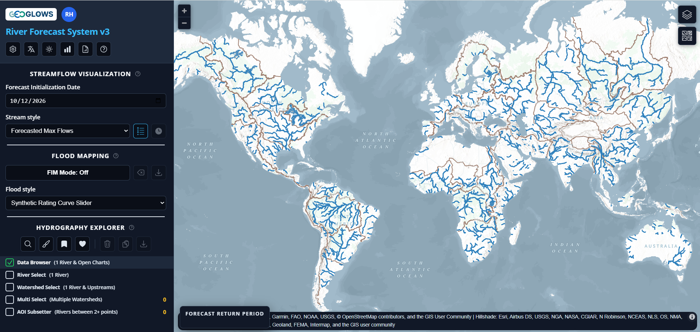

Le Hydroviewer comporte 3 sections principales : la visualisation des débits, les cartes d'inondation et l'explorateur d'hydrographie. Chacune de ces sections est expliquée plus en détail ci-dessous.

## 1. Visualisation des Débits

La visualisation des débits concerne la manière dont les cours d'eau sont affichés sur la carte. Le style des cours d'eau est défini à partir des données de prévision afin de permettre une lecture rapide. Par défaut, la date d'initialisation de la prévision (**Forecast Initialization Date**) correspond aux données les plus récentes disponibles. Cependant, si vous souhaitez afficher le style des cours d'eau d'après une prévision d'un autre jour, vous pouvez modifier la date d'initialisation de la prévision.

Vous pouvez également choisir dans le menu déroulant le style d'affichage des cours d'eau. Il existe 5 options différentes :

1. **Standard** : aucune coloration selon la prévision. Les rivières sont tracées uniquement selon leur taille.
2. **Forecasted Max Flows** (débits maximaux prévus) : chaque rivière est colorée selon la période de retour la plus élevée qu'elle devrait atteindre à un moment quelconque de la prévision. Cela permet d'identifier rapidement les rivières connaissant des débits élevés.
3. **15 Day Timeseries** (série temporelle sur 15 jours) : l'épaisseur (quantité d'écoulement) et la couleur (période de retour dépassée) de chaque rivière sont animées sur les pas de temps de 3 heures de la prévision. Utilisez le curseur temporel en bas de la carte pour lancer l'animation ou la parcourir pas à pas.
4. **Time to Peak** (délai avant le pic) : le temps restant avant que chaque rivière atteigne son débit maximal. C'est utile pour savoir de combien de temps on dispose avant un pic.
5. **Below Q95 Flow** (débit inférieur au Q95) : rivières dont le débit prévu est inférieur à leur débit d'étiage au 95e percentile, c'est-à-dire qu'elles sont anormalement sèches.

La légende, dans le coin de la carte, indique la signification de chaque couleur. Les deux boutons à côté du menu de style des cours d'eau affichent ou masquent la légende et le curseur temporel.

## 2. Cartographie des Inondations

La section de cartographie des inondations calcule des cartes d'inondation à la volée et les affiche sur la carte. Pour commencer à utiliser cette section, cliquez sur **FIM Mode** (mode cartographie des inondations) pour vous assurer qu'il est activé.

Sous le style d'inondation (flood style), vous pouvez choisir parmi 5 options différentes pour l'affichage de votre carte d'inondation. Ce choix détermine le débit utilisé pour la carte d'inondation.

1. **Synthetic Rating Curve Slider** (curseur de courbe de tarage synthétique) - Si vous sélectionnez cette option, un curseur apparaît. Vous pouvez déplacer le curseur pour ajuster le débit d'entrée de la carte d'inondation.
2. **Return Period Indexed** (indexé sur la période de retour) - Ne fonctionne pas actuellement
3. **Manually Specified Flow** (débit spécifié manuellement) - Si cette option est sélectionnée, vous pourrez saisir une valeur de débit d'entrée.
4. **Forecast Timeseries** (série temporelle de prévision) - Non disponible actuellement
5. **Forecast Maximum** (maximum de la prévision) - Non disponible actuellement

Une fois le style de carte sélectionné, cliquez sur un tronçon de cours d'eau sur la carte. Vous devrez peut-être zoomer pour le faire. Les tronçons colorés en rouge ne sont pas disponibles. Une carte d'inondation se charge alors. Pour cartographier une portion de rivière plus longue, cliquez sur un second tronçon en aval ; toute la rivière entre les deux tronçons est alors sélectionnée. Cliquez sur n'importe quelle zone inondée pour voir la profondeur d'eau approximative à cet endroit.

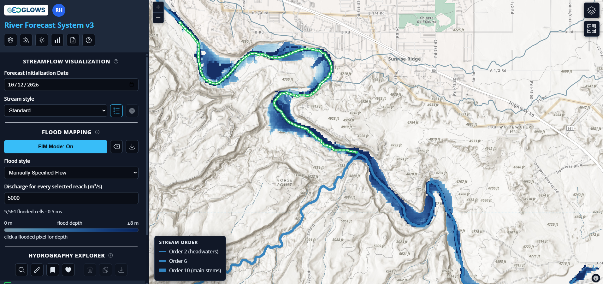

Cette carte d'inondation peut également être téléchargée en sélectionnant le bouton de téléchargement à côté du menu FIM. Cela télécharge un GeoTIFF de la carte d'inondation affichée. Vous pouvez le visualiser en le chargeant dans un logiciel SIG. Le bouton d'effacement situé à côté supprime les tronçons sélectionnés afin que vous puissiez recommencer.

!!! note "À propos des cartes d'inondation"
    Les cartes d'inondation sont produites avec les méthodes ARC et FLDPLN, qui cartographient les inondations à partir du relief. Elles n'intègrent pas de physique hydraulique 1D ou 2D et ne tiennent pas compte des digues, des ponceaux, des ponts, des infrastructures de drainage ni des conditions actuelles. Pour en savoir plus sur la production des cartes d'inondation, consultez la page [Cartographie des Inondations](../model-formulation/flood-mapping.md) de la section Formulation du Modèle.

## 3. Explorateur d'Hydrographie

Cette section sert à explorer l'hydrographie (le réseau de rivières) sur la carte. Les options de cette section déterminent ce qui se passe lorsque vous cliquez sur une rivière :

- **Data Browser** (navigateur de données) : sélectionne la rivière sur laquelle vous cliquez et ouvre ses graphiques. C'est l'option active au démarrage de l'application, et la seule qui ouvre les graphiques lorsque vous cliquez sur une rivière.
- **River Select** (sélection de rivière) : sélectionne uniquement la rivière sur laquelle vous cliquez, sans ouvrir ses graphiques.
- **Watershed Select** (sélection de bassin versant) : sélectionne toutes les rivières qui s'écoulent vers la rivière sur laquelle vous cliquez.
- **Multi Select** (sélection multiple) : ajoute un bassin versant entier à chaque clic, au lieu de remplacer la sélection précédente.
- **AOI Subsetter** (extraction d'une zone d'intérêt) : sélectionne une zone à l'intérieur d'un bassin versant. Cliquez d'abord sur l'exutoire, puis cliquez sur chaque entrée pour la retirer ainsi que tout ce qui se trouve en amont.

La ligne portant une coche correspond à l'option actuellement active. Par exemple, avec **Watershed Select** activé, cliquer sur la rivière Gunnison au Colorado la sélectionne ainsi que toutes les rivières situées en amont, qui sont mises en évidence en orange sur la carte. Le nombre à côté de l'option indique combien de rivières sont sélectionnées.

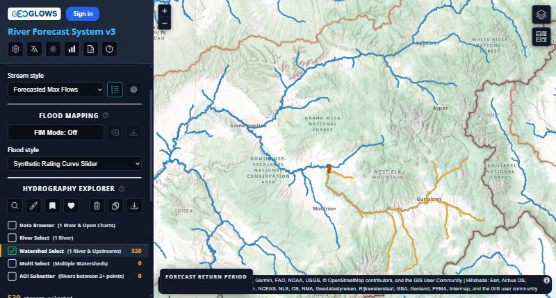

Les boutons au-dessus des options sont des outils pour travailler avec l'hydrographie :

- **Search** (recherche) : trouver une rivière par son nom ou par son identifiant de rivière à 9 chiffres.
- **Styling options** (options de style) : filtrer les rivières affichées et colorer le réseau de rivières selon vos propres règles.
- **Notable rivers** (rivières remarquables) : une liste de quelques-unes des rivières les plus grandes ou les plus connues du monde, à utiliser comme exemples.
- **Saved rivers** (rivières sauvegardées) : les rivières que vous avez sauvegardées (voir Sauvegarde des Rivières ci-dessous).
- **Clear** (effacer) : efface la sélection actuelle.
- **Copy** (copier) : copie les identifiants de rivière de la sélection actuelle, un par ligne.
- **Download** (télécharger) : télécharge les rivières sélectionnées et leurs sous-bassins sous forme de fichiers GeoParquet.

### Informations sur la Rivière Sélectionnée

Sous les options de sélection, le panneau affiche des informations sur ce qui est actuellement sélectionné. Il comporte deux parties :

1. **Un résumé de la sélection** : le nombre de rivières sélectionnées, l'identifiant de rivière et l'ordre hydrographique de l'exutoire (la rivière la plus en aval de la sélection), sa région, ainsi que la plage d'index de rivière couverte. Les boutons **Copy** et **Download** utilisent cette sélection.
2. **Les attributs de la dernière rivière sur laquelle vous avez cliqué** : son index de rivière, son identifiant de rivière, l'identifiant de l'exutoire vers lequel elle s'écoule, l'identifiant de la rivière suivante en aval, sa région TDX-Hydro, le nombre de rivières en amont, ses ordres de Strahler et de Shreve, sa longueur, la superficie totale qui s'y draine (superficie contributive) et la superficie de son propre sous-bassin.

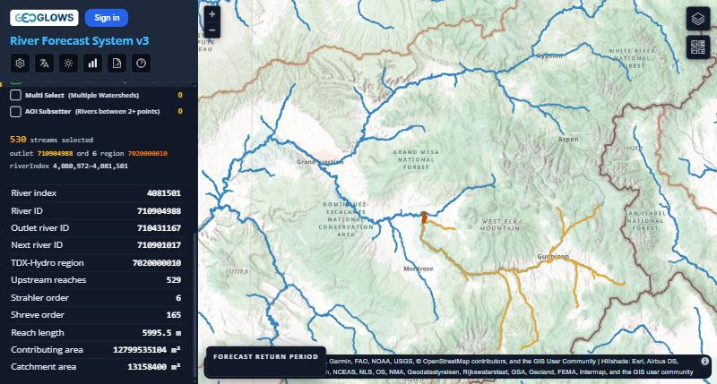

### Rechercher une Rivière

Pour trouver une rivière précise :

1. Cliquez sur le bouton de recherche (loupe) dans l'explorateur d'hydrographie.
2. Recherchez par **River name** (nom de rivière) ou par **River ID** (identifiant de rivière) :
    - **River name** : commencez à saisir un nom, par exemple « Colorado ». Une liste de rivières correspondantes apparaît, avec le pays de chacune, afin que vous puissiez choisir la bonne lorsque plusieurs rivières portent le même nom.
    - **River ID** : saisissez l'identifiant à 9 chiffres de la rivière, par exemple 760021611, puis cliquez sur **Search** (rechercher).
3. La carte zoome sur la rivière et la sélectionne.

La première fois que vous effectuez une recherche par identifiant, l'application télécharge un index des identifiants de rivière (environ 17 Mo). Ensuite, la recherche par identifiant est instantanée.

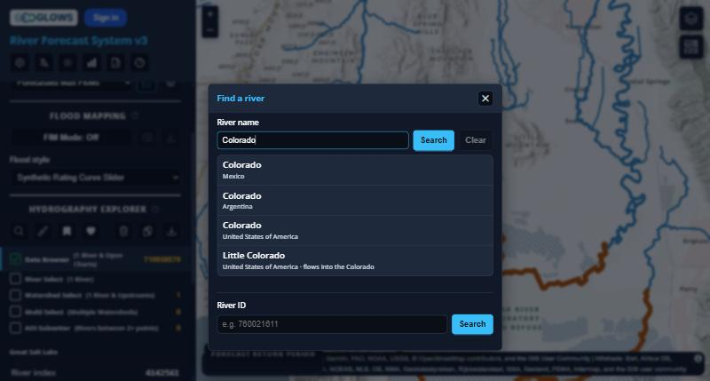

### Filtrer les Rivières

Le bouton de style (pinceau) de l'explorateur d'hydrographie ouvre le panneau **Styling Options** (options de style), dans lequel vous pouvez choisir quelles rivières sont affichées sur la carte et comment elles sont colorées.

- **Préréglages** : choisissez un style prêt à l'emploi dans le menu **Preset** (préréglage), comme « Big rivers only » (grandes rivières uniquement), « Order ramp » (coloré selon l'ordre hydrographique) ou « By contributing area » (selon la superficie contributive).
- **Filtres** : chaque attribut de rivière de la liste, comme l'ordre hydrographique, la superficie contributive ou la région TDX-Hydro, dispose d'un bouton **+ filter** (ajouter un filtre). Utilisez-le pour n'afficher que les rivières qui remplissent une condition, par exemple uniquement les rivières d'ordre de Strahler égal ou supérieur à 5. Les filtres que vous ajoutez sont listés sous **Global Visibility Filters** (filtres de visibilité globaux).
- **Règles de style** : utilisez les boutons **+ rule** (ajouter une règle) pour colorer les rivières selon un attribut. Les règles sont listées sous **Attribute Styling Rules** (règles de style par attribut), et c'est la première règle correspondant à une rivière qui est appliquée.
- **Noms de rivières** : cochez **River names** (noms de rivières) pour colorer le réseau de rivières à l'aide de la table des rivières nommées.

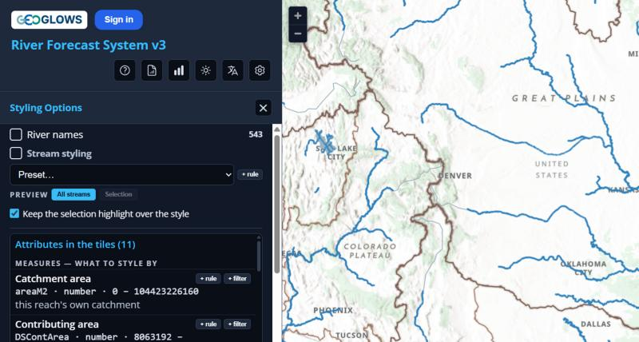

### Rivières Remarquables

Le Hydroviewer comprend une liste de rivières suggérées qui constituent de bons exemples pour explorer l'application. Cliquez sur le bouton des rivières remarquables (**Notable rivers**) dans
l'explorateur d'hydrographie pour ouvrir la liste. Chaque rivière dispose de deux boutons : l'icône de graphique ouvre les graphiques de la rivière, et l'icône de localisation zoome la carte
sur la rivière. Ces identifiants de rivière peuvent également être saisis dans la recherche pour trouver directement les rivières.

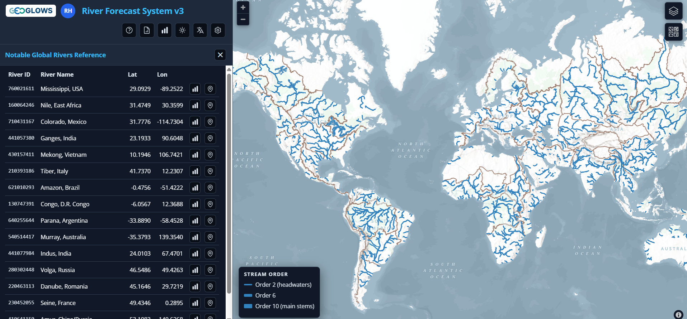

## Couches et Cartes de Base

Utilisez le bouton des couches, en haut à droite de la carte, pour activer des couches supplémentaires, et le bouton des cartes de base situé en dessous pour changer de carte de base. Les couches comprennent les cartes d'inondation, les sous-bassins, les limites des régions, les limites HydroBASINS de niveau 2, ainsi que des observations satellitaires et des observations d'inondations en temps quasi réel, comme le composite mondial d'inondations RIVER-FLD, l'imagerie infrarouge GOES / Himawari et l'imagerie en couleurs naturelles VIIRS.

## Afficher les Graphiques

Vous pouvez également afficher les graphiques des rivières sélectionnées. Les graphiques présentent des informations sur les données de prévision et les données rétrospectives. Pour les afficher, assurez-vous que le mode FIM (**FIM Mode**) est désactivé. Sélectionnez ensuite l'icône de graphique en haut ; ou, si **Data Browser** (navigateur de données) est sélectionné dans l'explorateur d'hydrographie, les graphiques d'une rivière s'affichent lorsque vous cliquez dessus. Vous pouvez aussi ouvrir les graphiques d'une rivière en la recherchant, ou en la choisissant dans la liste des rivières remarquables ou des rivières sauvegardées.

Les graphiques s'ouvrent dans le panneau latéral et comportent trois onglets :

- **Forecast** (prévision) : la prévision à 15 jours pour la date de prévision sélectionnée.
- **Retrospective** (rétrospective) : l'historique simulé de la rivière, remontant à 1940, et les graphiques qui en sont dérivés.
- **Details** (détails) : des informations de base sur la rivière, comme son identifiant et sa localisation.

## Graphiques de Prévision

Par défaut, la prévision à 15 jours à partir du jour courant s'affiche. Cependant, si vous le souhaitez, vous pouvez afficher une prévision d'un jour précédent en choisissant une autre date d'initialisation de la prévision (**Forecast Initialization Date**) dans la section Visualisation des Débits.

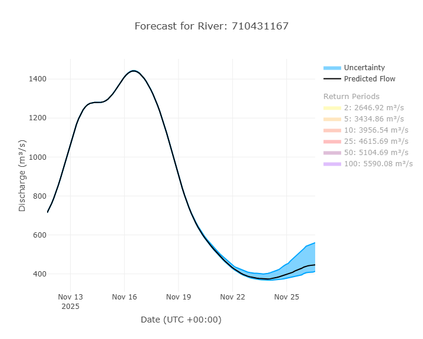

Un exemple de graphique de prévision est présenté ici. Le graphique montre la prévision médiane, la dispersion des membres de l'ensemble et les seuils de période de retour pour cette rivière. Plus d'informations sur l'interprétation de ce graphique se trouvent dans la section [Données de Prévision](../data/available-data.md#donnees-de-prevision-a-15-jours) de cette formation.

## Graphiques Rétrospectifs

Vous pouvez consulter les données rétrospectives en sélectionnant l'onglet **Retrospective** (rétrospective). Utilisez les boutons au-dessus du graphique pour afficher les 1, 5, 10 ou 30 dernières années, ou l'ensemble de l'historique. Vous pouvez également tracer un rectangle sur le graphique pour zoomer.

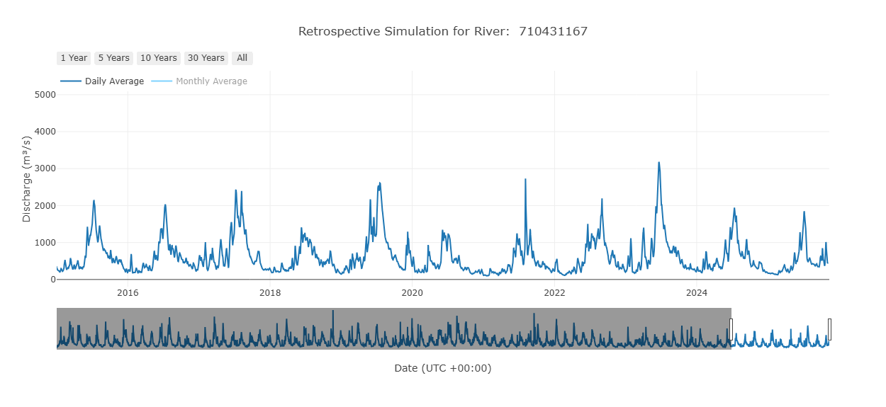

Il s'agit du graphique rétrospectif principal, mais il existe d'autres graphiques dérivés de ces données rétrospectives. Ils sont conçus pour aider à interpréter et à analyser les données. Ils représentent des interprétations des données rétrospectives, sans être exhaustifs. Tous les graphiques ne seront pas utiles dans tous les cas d'utilisation. Les graphiques disponibles évoluent en fonction des recherches en cours.

### Débit Cumulé Annuel

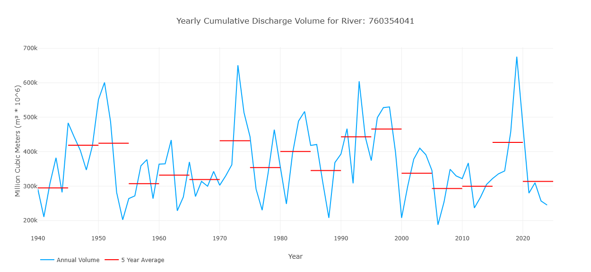

Ce graphique montre une valeur pour chaque année de la simulation rétrospective, représentant le volume total écoulé au cours de cette année pour ce cours d'eau. Elle est représentée par la ligne bleue du graphique. Les lignes rouges montrent les moyennes du volume sur 5 ans afin de représenter l'évolution possible du volume du cours d'eau au fil du temps.

### Volume Cumulé par Année

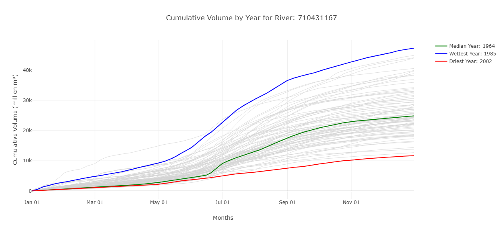

Ce graphique montre le volume cumulé en millions de mètres cubes tout au long de l'année. Les années les plus humides et les plus sèches sont étiquetées pour donner une idée de la plage de valeurs observées dans le passé. En survolant une ligne dans le Hydroviewer, l'année correspondant à chaque ligne s'affiche. Ce graphique montre également à quel moment le volume d'eau augmente le plus rapidement, ce qui correspond à un débit plus important.

### Débit Moyen Mensuel avec Catégories HydroSOS

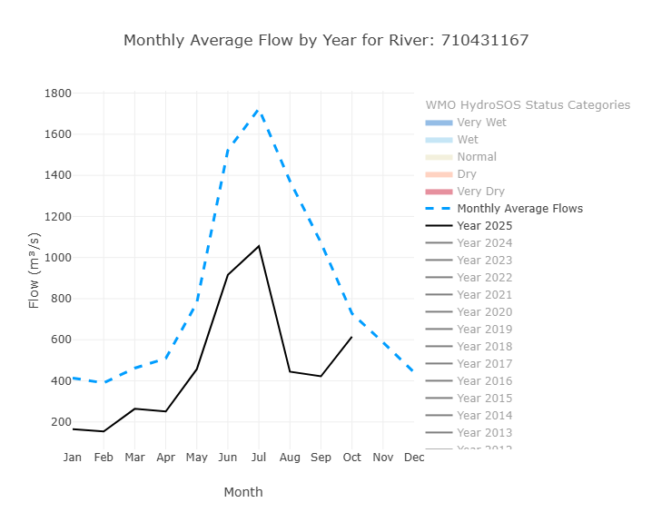

Ce graphique comporte des éléments qui peuvent être activés ou désactivés pour mettre en évidence différents aspects.
La vue par défaut montre les débits moyens mensuels sur toute la période d'enregistrement (la ligne bleue pointillée) et les moyennes mensuelles de l'année en cours (la ligne noire). D'autres années peuvent être activées ou désactivées pour comparer leurs moyennes mensuelles.
De plus, les niveaux HydroSOS peuvent être activés ou désactivés pour montrer la plage des conditions de débit (très sec, sec, normal, humide et très humide) tout au long de l'année. Cela repose sur les méthodes développées par l'OMM pour son initiative HydroSOS. Les plages des catégories sont calculées à partir des moyennes mensuelles historiques. Les valeurs de chaque mois sont classées séparément et se voient attribuer un percentile. Ces percentiles servent ensuite à définir les seuils de chaque catégorie.
Ce graphique aide les utilisateurs à comprendre comment les débits d'une rivière pour une année donnée se comparent à ce qui est considéré comme normal, et si les conditions ont été plus humides ou plus sèches que d'habitude pour chaque mois.

### Débit de Pointe Annuel

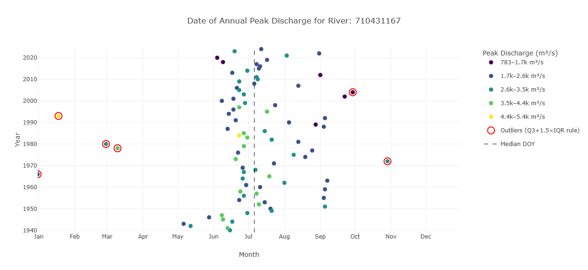

Ce graphique est conçu pour présenter des informations sur le débit de pointe d'une rivière. La position indique le moment où le débit s'est produit et la couleur indique la quantité d'eau. L'axe des y représente les différentes années. La position d'un point le long de l'axe des x indique à quel moment de l'année le débit de pointe s'est produit. Les couleurs représentent la valeur du débit de pointe au moment où il s'est produit. Les valeurs aberrantes sont mises en évidence en rouge.

### Hydrogramme Raster

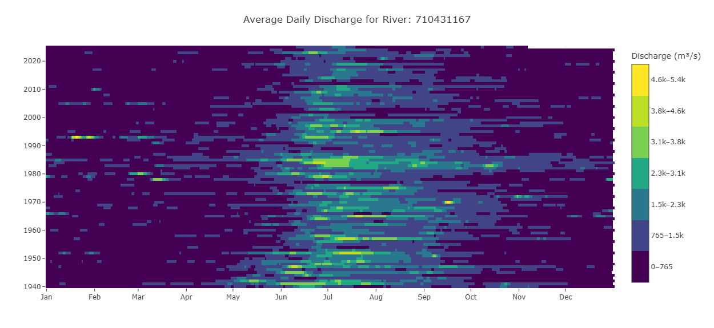

Un hydrogramme raster est une visualisation en grille montrant la variation temporelle du débit d'une seule rivière. L'axe des x représente les mois, l'axe des y représente les années, et la couleur de chaque cellule indique l'ampleur du débit. L'intérêt est de pouvoir visualiser les 85 années d'un seul coup d'œil. Parcourir une ligne montre le débit d'une année, tandis que parcourir une colonne de haut en bas montre la même date pour toutes les années, par exemple chaque 15 mars. Cela permet d'identifier facilement les régimes saisonniers, de repérer rapidement les périodes humides et sèches, et de détecter les valeurs aberrantes ou les années où la saison humide a été plus longue ou plus courte que la normale.

### Courbe de Durée des Débits

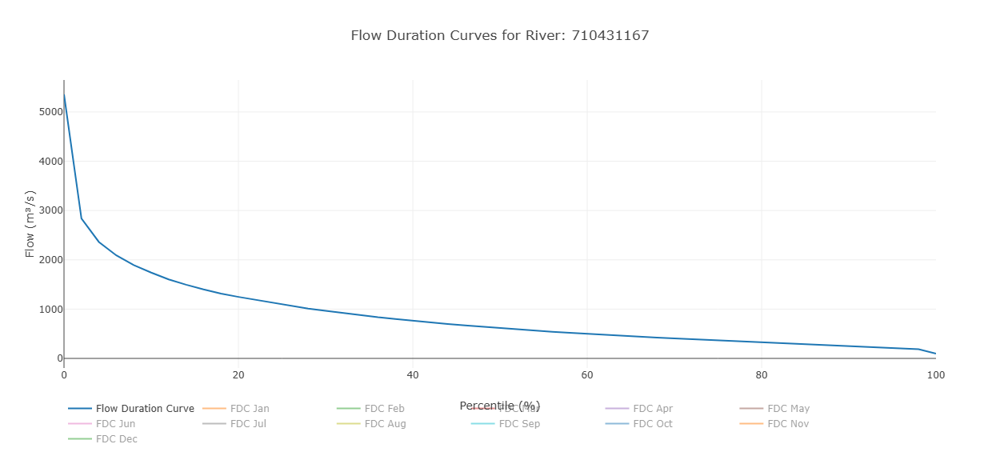

Ce graphique affiche le débit sur l'axe des y et la probabilité de dépassement sur l'axe des x. Chaque point représente une valeur de débit mensuel et indique à quelle fréquence ce niveau de débit est dépassé. En plus des valeurs mensuelles individuelles, le graphique comprend une courbe globale de durée des débits basée sur l'ensemble des données. Cela permet aux utilisateurs de comparer les régimes d'écoulement mensuels à la distribution des débits à long terme. Par défaut, seule la courbe globale est affichée ; les mois individuels doivent être activés pour être visibles.

## Détails

L'onglet **Details** (détails) présente des informations de base sur la rivière sélectionnée :

- **riverId** : l'identifiant unique à 9 chiffres de la rivière. Utilisez ce numéro pour retrouver la rivière ou pour consulter ses données.
- **lat** et **lon** : la latitude et la longitude de la rivière.
- **riverIndex** : la position de la rivière dans l'ordre du réseau de rivières utilisé par les fichiers de données du RFS.
- **upstreamCount** : le nombre de tronçons de rivière situés en amont de cette rivière. Un nombre élevé signifie que la rivière draine un vaste réseau, comme un grand fleuve près de son exutoire.

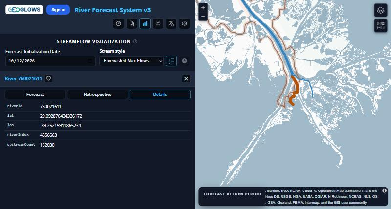

## Sauvegarde des Rivières

Pour sauvegarder une rivière, ouvrez ses graphiques et cliquez sur l'icône en forme de cœur à côté du nom de la rivière, puis donnez-lui un nom. Les rivières sauvegardées sont mises en évidence par un contour sur la carte et listées sous le bouton des rivières sauvegardées (**Saved rivers**) dans l'explorateur d'hydrographie, où elles peuvent être triées par nom ou par identifiant de rivière. La sauvegarde de rivières nécessite d'être connecté (voir Paramètres ci-dessous).

## Rapports de Prévision

Le bouton des rapports, en haut du panneau latéral, génère un document imprimable pour une liste de rivières : soit vos rivières sauvegardées, soit les rivières remarquables. Il existe deux types de rapport :

- **Daily Forecast Report** (rapport de prévision quotidien) : une page par rivière, avec la prévision à 15 jours, un tableau indiquant la probabilité de dépasser chaque période de retour pour chaque jour, et un espace pour des notes.
- **Flood Alerts Bulletin** (bulletin d'alertes d'inondation) : une page par rivière, avec en tête une alerte d'inondation codée par couleur, les débits de pointe et moyens, et une comparaison entre la prévision et le débit que la rivière transporte habituellement à cette période de l'année.

Choisissez le type de rapport, la liste de rivières et la date de prévision, puis cliquez sur **Generate** (générer). Une fois le rapport terminé, utilisez **Print / Save as PDF** (imprimer / enregistrer en PDF) pour l'enregistrer.

## Aide, Langue et Affichage

Les boutons en haut du panneau latéral comprennent quelques options pour obtenir de l'aide et modifier l'apparence de l'application :

- **Help** (aide, point d'interrogation) : ouvre un panneau qui explique plus en détail chaque partie de l'application, y compris les raccourcis clavier.
- **Language** (langue) : fait passer l'application de l'anglais à l'espagnol ou au français, et inversement.
- **Theme** (thème, icône de soleil) : bascule entre le mode clair et le mode sombre.

## Paramètres

Vous pouvez vous connecter avec le bouton **Sign in** (se connecter) en haut du panneau latéral. Il s'agit du même identifiant GEOGLOWS que celui utilisé pour le [magasin de données](../data/accessing-data/datastore.md), qui exige une connexion pour télécharger des données. La connexion vous permet de vous inscrire aux listes de diffusion GEOGLOWS et de sauvegarder des rivières. Vos rivières sauvegardées sont enregistrées dans votre profil ; elles sont donc disponibles sur tout appareil à partir duquel vous vous connectez.

Le menu des paramètres (l'icône en forme d'engrenage en haut du panneau latéral) contient des options d'affichage, comme l'ombrage des niveaux d'alerte sur les graphiques et le contour des rivières sauvegardées sur la carte. Il liste également les données que l'application a copiées sur votre appareil pour être plus rapide, comme l'index des identifiants de rivière utilisé pour la recherche. Ces copies peuvent être supprimées à tout moment.
