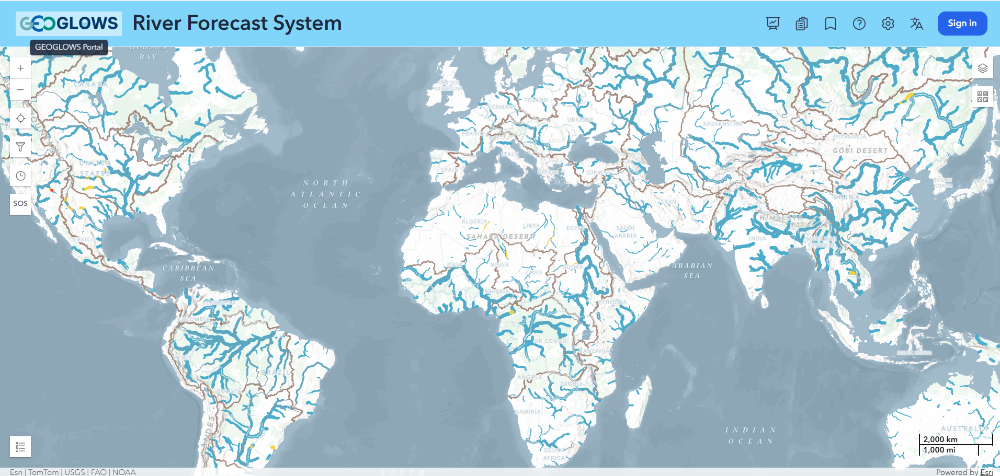
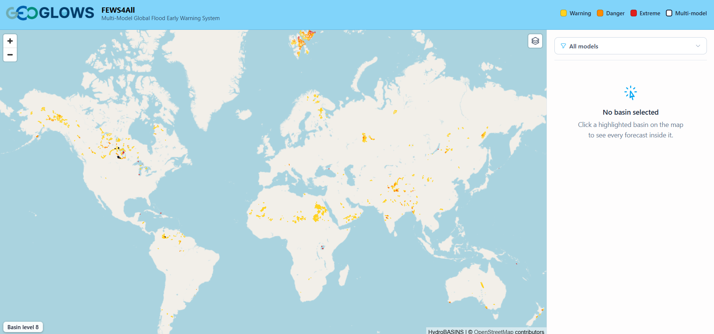
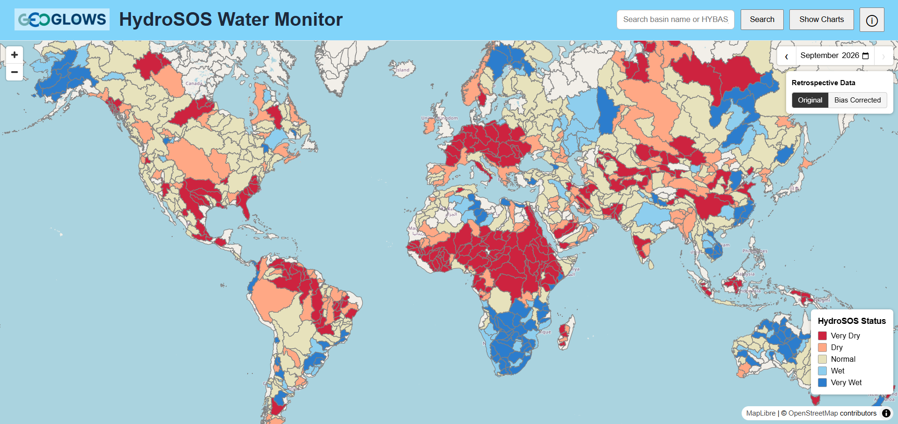

# Web Applications

One way to visualize, download, and interact with the RFS data is through a series of web applications available through [apps.geoglows.org](https://apps.geoglows.org). RFS has one main web application called the Hydroviewer. This app provides data visualization and downloads. It provides a series of charts, graphs, and maps to best communicate data to users. There are more specific instructions available on the [Hydroviewer](hydroviewer.md) page.

Additionally, there are several additional web applications maintained on [apps.geoglows.org](https://apps.geoglows.org). Some of these applications may change over time based on need and use. Each of these applications has a specific audience and purpose. They are all driven through the RFS data and represent one way that the data could be used. Further applications and customizations are possible if users download and use the data themselves from the [datastore](../data/accessing-data/datastore.md).  Each of the web applications provide specific visualization and interpretation for the data, which can make it faster and easier to use the data. An overview of the applications is given here, and then they are explained in further detail in the application itself.

If you are interested in local or custom applications, there are options for contracting with [Aquaveo LLC](https://aquaveo.com) to help with support and creation of the applications. If you are interested please reach out to [rhuber@aquaveo.com](mailto:rhuber@aquaveo.com).

## The Hydroviewer

- **Link:** [https://apps.geoglows.org/rfs](https://apps.geoglows.org/rfs#lon=10.00&lat=18.00&zoom=3.00&definition=)
- **Main Purpose:** Provide easy data visualizations and downloads
- **Target Audience:** Technical users who would like to be able to quickly visualize data on some of their streams of interest.

## Other Applications

### FEWS (Flood Early Warning System)

- **Link:** [https://apps.geoglows.org/previews/fews4all](https://apps.geoglows.org/previews/fews4all)
- **Main Purpose:** Provide flood warnings
- **Target Audience:** Non-technical users who may want to see if they are going to experience a flood without downloading the data themselves.

### HydroSOS

- **Link:** [https://apps.geoglows.org/hydrosos](https://apps.geoglows.org/hydrosos)
- **Main Purpose:** Display the HydroSOS categories according to the WMO’s protocol
- **Target Audience:** Users with the WMO

